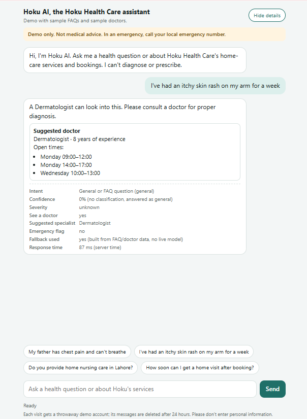
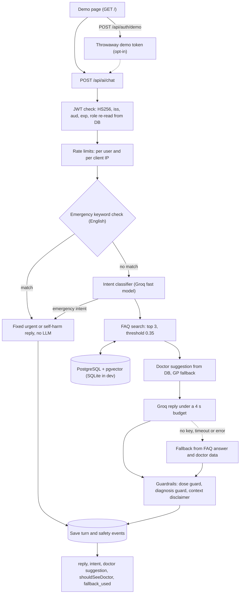

# Hoku Health Care AI Chatbot

FastAPI health-care chatbot backend: it detects emergencies before any AI call, answers service questions from an FAQ index in PostgreSQL with pgvector, suggests a doctor type, and replaces any reply that states a medicine dose or a diagnosis.

Built during my TechNexus internship for a real client (Hoku Health Care); published with permission.


## Live demo

Live demo: deploying this week (link coming soon).

The first request after a quiet period may be slow while the service starts.



The screenshot was taken in offline fallback mode (no Groq key), so the reply is built from the FAQ and doctor data.

> **Demo only, not medical advice.** The FAQ entries and doctors are sample data. The chatbot gives general information and does not diagnose. In an emergency, call your local emergency number.

## What it does

A visitor asks a health or service question: symptoms, medicines, booking, what Hoku offers. The backend checks for an emergency first and, if it finds one, answers with a fixed urgent message and skips the AI model. Otherwise it classifies the intent, looks up the most relevant FAQ entries (sentence embeddings, pgvector on PostgreSQL), suggests a doctor type from the database, and asks a Groq-hosted LLM to write a short plain-text reply under a 4-second time budget. Guardrails then check the reply: any stated dose, amount or dosing interval, or diagnosis wording, replaces it with a fixed safe message. Without a Groq key, or if Groq is slow or fails, the reply is built from the matched FAQ answer and the doctor data (`fallback_used: true`).

## Key features

- **Real authentication:** `POST /api/auth/login` checks a bcrypt password hash and returns an HS256 JWT with `sub`, `role`, `iat`, `exp`, `iss` and `aud`. The role is re-read from the database on every request. There is no default admin; `app.scripts.create_user` creates accounts. The app refuses to start outside `ENVIRONMENT=test` with a `SECRET_KEY` shorter than 32 characters, and the error never prints the key.
- **Role-based access:** two roles, `patient` and `admin`. The FAQ seed, FAQ debug search and monitoring routes are admin-only (403 for patients). `/metrics` needs a scrape token and returns 404 when none is set outside test and development.
- **Opt-in demo login:** `POST /api/auth/demo` (off by default, 404 when off) creates a throwaway patient account and a 15-minute token. Demo users and their data are purged after 24 hours. It is limited per client IP (default 20 per hour).
- **Emergency detection:** an English keyword list (apostrophes normalised, documented in the code) runs before any LLM call, and the intent classifier's `emergency` intent is a second signal. Both give the same fixed reply, an `X-Hoku-Emergency` header and a safety-log event. Self-harm wording gets a separate reply with crisis wording and no phone numbers. The keyword list is English only.
- **Dose guard and other guardrails:** any stated dose, amount or dosing interval replaces the reply with a fixed medication message. Diagnosis and prescription wording is blocked by a 3-attempt sanitise-and-retry loop that ends in a fixed fallback. Conditional wording ("if you have a fever...") is not treated as a diagnosis.
- **Context-aware disclaimer:** health replies end with "Please consult a doctor for proper diagnosis."; service, booking and FAQ replies end with "General information only, not medical advice."; the self-harm reply points to a doctor or a mental-health professional. A disclaimer is always present, and `shouldSeeDoctor` is false for booking, service and FAQ replies.
- **Doctor suggestion with GP fallback:** symptoms are mapped to a specialty (rapidfuzz), and available doctors come from the database, never from the model. If no doctor of that specialty exists, a General Physician is returned with `requested_specialist` set.
- **pgvector RAG on PostgreSQL with Alembic:** 20 sample FAQs embedded locally with `all-MiniLM-L6-v2` (384 dimensions), top 3, cosine similarity threshold 0.35, HNSW index. SQLite uses an in-Python cosine fallback for development. Alembic migrations cover every table (users, doctors, availability, FAQ vectors, chat history, safety logs), and `alembic check` reports no drift on SQLite and PostgreSQL.
- **Deterministic fallbacks:** with no key, a Groq error or a timeout, the reply comes from the matched FAQ answer and the doctor data, and the response says `fallback_used`.
- **Logging privacy:** tests capture the logs and check that message text, symptom text, matched emergency keywords and exception text do not appear. Emergency safety events store only a placeholder with the message length. The Groq SDK logger is pinned to WARNING because the SDK logs request bodies at DEBUG.
- **Proxy-aware rate limits:** with `TRUST_PROXY`, the client IP is the right-most `X-Forwarded-For` entry (entries a client adds on the left are ignored). It feeds the demo-login limit and a per-IP chat cap (default 20 per minute) on top of the per-user limit (default 10 per minute).
- **Demo page** at `GET /`: example questions, a "Show details" panel (intent, doctor suggestion, fallback flag, response time), a visible "Demo only" banner, a hash-based CSP, and the token kept in memory only.
- **Docker with locked dependencies:** CPU-only PyTorch, a non-root user (uid 1000), the embedding model baked in with Hugging Face offline at runtime, and `constraints.txt` locking all 92 runtime packages. Docker Compose runs PostgreSQL with pgvector, a one-shot migration service and the app. The GitHub Actions workflow runs ruff, `mypy app`, tests with an 80% coverage gate, a pgvector job and a Docker job, with no API key.

## Architecture



## Engineering decisions

- **Emergency check before the model.** A fixed reply cannot go wrong in a new way and needs no AI call. Offline in the local Docker run it took 25 ms of server time.
- **Fixed messages instead of repair.** A reply with a dose, or with diagnosis wording after 3 attempts, is replaced, not edited. The reply prompts also forbid doses.
- **Doctor data from the database, not the model.** The LLM never names a doctor.
- **Score computed in SQL.** On PostgreSQL the similarity is `1 - (embedding <=> query)` inside the query, so the result does not depend on how the driver returns vectors (see Bugs found by testing).
- **Role re-checked against the database.** A token cannot keep admin rights after the account changes.
- **Strict start-up guards.** No default secret, no default admin, demo login off by default, `/metrics` closed by default.
- **No LLM in tests or CI.** Groq is mocked and the tests run with no API keys.
- **One instance.** Rate limits, the response cache and metrics live in memory; see Limitations.
- **Locked dependencies.** Direct pins in `requirements.txt`, every transitive version in `constraints.txt`, and a CI check inside the image that a Groq client can be created.

## Bugs found by testing

- **pgvector search silently returned 0 results on PostgreSQL.** Earlier tests ran on SQLite or replaced retrieval with a fake, so they passed. The first test against real PostgreSQL showed that `row.embedding` comes back as a numpy array: `if not vec:` raised a `ValueError`, a broad `except` swallowed it, and every query returned nothing. So FAQ grounding never worked on PostgreSQL. It is fixed by computing the score in SQL, and the real-PostgreSQL suite now covers it.
- **The Groq client could not be created in the Docker image.** The image had resolved `httpx 0.28.1`, but the pinned `groq 0.9.0` passes `proxies=` to httpx, which raises a `TypeError`. Running the test suite inside the image showed 7 failures. Every reply from that image would have been a fallback even with a valid key. I had first put the smoke-check failures down to "no key". It is fixed by pinning `httpx==0.27.0` (plus `numpy` and `regex`), locking everything in `constraints.txt`, and checking in CI that a Groq client can be created.
- **The client IP could be spoofed.** The first Dockerfile started uvicorn with `--proxy-headers --forwarded-allow-ips '*'`, so a caller could set their own IP and slip past per-IP limits. Now uvicorn runs with `--no-proxy-headers`, and the app reads the right-most `X-Forwarded-For` entry only when `TRUST_PROXY` is on.

## Results

Measured on 2026-11-09 on a Windows 11 PC with Docker Desktop, inside the project's Docker image, with no API keys. These are local measurements, not figures from a hosted demo.

| Area | Result |
|---|---|
| Tests | 714 collected: 705 passed, 0 failed, 9 skipped (the pgvector tests, which skip on SQLite); no API key needed (LLM mocked) |
| Coverage | 88.52% line coverage with no omitted files (CI fails below 80%) |
| Type checking | `mypy app`: 0 errors, strict optional on (65 files) |
| Lint | `ruff check` and `ruff format --check`: clean |
| pgvector tests on real PostgreSQL | 9 of 9 passed (`pgvector/pgvector:pg16`, pgvector 0.8.7), including a non-superuser migration test |
| Retrieval, dev set | hit@1 0.938, hit@3 1.000, MRR 0.964; off-topic questions rejected 8 of 8 |
| Retrieval, held-out set | hit@1 0.900, hit@3 0.900, MRR 0.900; off-topic questions rejected 10 of 12 |
| Docker image | 2.41 GB on disk (`docker images`); 566.6 MB compressed content (`docker image inspect`); CPU-only PyTorch |
| Docker startup | about 10 s from `docker run` to `rag_ready: true` (migrations and embedding the 20 FAQs included) |
| Docker RAM | 541.7 MiB after 4 chats (SQLite, no Groq key; measured on the previous build of the same image, not repeated) |
| Live latency (p50 / p95) | to be measured after deployment |

**Retrieval evaluation.** `scripts/eval_retrieval.py` runs each question through the app's own retrieval (real `all-MiniLM-L6-v2`, top 3, threshold 0.35, no LLM). Both sets in `data/eval/` are **written by the project author, not real user traffic**. The dev set has 32 in-scope and 8 off-topic questions. The held-out set (20 in-scope, one per FAQ, and 12 off-topic, 6 of them near-topic) was written and committed before any measurement and was never used to choose the threshold. The numbers are identical on SQLite and on pgvector. The threshold stayed at 0.35: it is the lowest value that rejects all 8 dev off-topic questions.

**Known leaks (held-out set).** Two off-topic questions pass the threshold: "What are the opening hours of Lahore's Emporium mall?" (0.468) and "Does Amazon deliver to Lahore?" (0.363). Two in-scope questions are missed even at top 3 ("Which kinds of care can Hoku send to my house?" and "Can a nurse come late at night?"). The reply prompt asks the model to decline off-topic questions; whether the live model does so is **not measured**. Details are in [data/eval/README.md](data/eval/README.md).

The 4-second budget (3.5 s Groq timeout) is a design limit, not a measured result. Start-up and RAM are local Docker figures; Cloud Run, Neon and real Groq latency have not been measured.

## Run locally

Requires Docker Desktop. Windows (PowerShell) commands:

```powershell
git clone https://github.com/ameema28/hoku-health-ai.git
cd hoku-health-ai
# Generate a secret into an environment variable without printing it:
$env:SECRET_KEY = python -c "import secrets; print(secrets.token_urlsafe(48), end='')"
# Optional, for live answers: copy .env.example to .env and set GROQ_API_KEY there.
docker compose up -d --build
```

Compose starts PostgreSQL with pgvector, a one-shot `migrate` service (Alembic migrations, then idempotent seeding of 7 sample doctors and 20 FAQs), and the app. Open http://localhost:8000/ for the demo page (demo login is on in Compose) or http://localhost:8000/docs for Swagger UI. Without a Groq key, every reply is a fallback built from the FAQ and doctor data. Stop with `docker compose down` (add `-v` to delete the database).

Create an account (there is no default admin; the password is prompted twice, hidden):

```powershell
docker compose exec app python -m app.scripts.create_user --email you@example.com --role admin
```

`--role` is `patient` (default) or `admin`; `--reset-password` sets a new password for an existing user. See [DEPLOYMENT.md](DEPLOYMENT.md) for a single-container run, Cloud Run and Neon settings, and the post-deploy checks.

### Environment variables

| Variable | Default | Meaning |
|---|---|---|
| `SECRET_KEY` | none (required, 32+ characters) | Signs the JWTs. The app will not start without it outside `ENVIRONMENT=test` |
| `DATABASE_URL` | a local PostgreSQL URL (the Docker image uses SQLite in `/tmp`) | SQLAlchemy URL; PostgreSQL needs pgvector |
| `GROQ_API_KEY` | none | Missing: every reply is a fallback |
| `GROQ_FAST_MODEL` / `GROQ_MAIN_MODEL` | `llama-3.1-8b-instant` / `llama-3.3-70b-versatile` | Fast model for intent and symptoms; main model writes the reply |
| `GROQ_TIMEOUT_SECONDS` | `3.5` | Timeout of each Groq call (no retries) |
| `ENVIRONMENT` | `development` | `test` makes the app ignore `.env` |
| `DEMO_LOGIN_ENABLED` | `false` | Enables `POST /api/auth/demo` (needed for the demo page) |
| `DEMO_TOKEN_EXPIRE_MINUTES` / `ACCESS_TOKEN_EXPIRE_MINUTES` | `15` / `30` | Token lifetimes |
| `DEMO_RATE_LIMIT_PER_HOUR` | `20` | Demo sessions per client IP per hour |
| `RATE_LIMIT_ENABLED` | `true` | Switch for the chat rate limits |
| `RATE_LIMIT_REQUESTS_PER_MINUTE` | `10` | Chats per user per minute |
| `CHAT_IP_RATE_PER_MINUTE` | `20` | Chats per client IP per minute |
| `TRUST_PROXY` / `TRUST_PROXY_HOPS` | `false` / `1` | Read the client IP from `X-Forwarded-For` (right-most entry by default) |
| `JWT_ISSUER` / `JWT_AUDIENCE` | `hoku-health-ai` / `hoku-health-api` | Required token claims |
| `RAG_SIMILARITY_THRESHOLD` / `RAG_TOP_K` | `0.35` / `3` | FAQ grounding cutoff and result count |
| `METRICS_TOKEN` | none | Bearer token for `/metrics` (404 outside test and development without it) |
| `CORS_ALLOW_ORIGINS` | `http://localhost:5173,http://localhost:3000` | Browser origins allowed to call the API |
| `DB_AUTO_MIGRATE` | `true` in the Docker image (`false` for the Compose app, which has a migrate service) | Run migrations and seeding at container start (single instance only) |
| `DB_POOL_SIZE` / `DB_MAX_OVERFLOW` | `10` / `20` | PostgreSQL connection pool |
| `LOG_FORMAT` / `LOG_LEVEL` | `json` / `INFO` | Logging |
| `HOKU_NEW_USER_PASSWORD` | none | Password for `create_user` (CLI only; otherwise prompted) |

## Testing

No API key is needed: Groq is mocked in every test. The tests run in Docker, not in a host virtual environment. This builds the image, installs the test tools inside a throwaway container (the repo is mounted read-only, so nothing is written into it), then runs the tests, ruff and mypy:

```powershell
docker build -t hoku-health-ai:local .
docker run --rm -u root -e ENVIRONMENT=test -e RATE_LIMIT_ENABLED=false -e PYTHONDONTWRITEBYTECODE=1 -e COVERAGE_FILE=/tmp/.coverage -v "${PWD}:/work:ro" -w /work --entrypoint sh hoku-health-ai:local -c "pip install -q --root-user-action=ignore -r requirements-dev.txt -c constraints.txt && pytest tests --ignore=tests/load -p no:cacheprovider -q && ruff check --no-cache app tests scripts && ruff format --check --no-cache app tests scripts && mypy --cache-dir=/tmp/mypy app"
```

`ENVIRONMENT=test` and `RATE_LIMIT_ENABLED=false` are what CI sets; without them some tests fail. The pgvector tests (`pytest tests/pgvector -m pgvector --no-cov`) skip on SQLite and need `DATABASE_URL` pointing at a PostgreSQL database with pgvector; the CI workflow runs them against `pgvector/pgvector:pg16`. `tests/load` (locust) is excluded from CI and was not run.

Scripts in `scripts/` (standard library only, no key): `eval_retrieval.py` (retrieval evaluation), `smoke_check.py --url <URL>` and `benchmark.py --url <URL>` (post-deploy checks, see [DEPLOYMENT.md](DEPLOYMENT.md)). Their output files must be outside the repository.

## API

| Method | Path | Auth | Description |
|---|---|---|---|
| `GET` | `/` | none | Demo page |
| `GET` | `/health`, `/api/ai/health` | none | Status and `rag_ready` |
| `POST` | `/api/auth/login` | none | Email and password, returns a JWT |
| `POST` | `/api/auth/demo` | none | Throwaway demo session (404 unless `DEMO_LOGIN_ENABLED`) |
| `POST` | `/api/ai/chat` | JWT | Reply, intent, doctor suggestion, `shouldSeeDoctor`, `fallback_used`; message up to 1000 characters |
| `GET` | `/api/ai/chat/history` | JWT | The user's chat history (`limit` 1-100, `skip`) |
| `GET` | `/api/ai/doctors` | JWT | Available doctors for a `specialty` (required query parameter) |
| `GET` | `/api/ai/doctors/{id}/availability` | JWT | A doctor's availability |
| `POST` | `/api/ai/rag/seed` | admin | Seed the FAQ vector store (idempotent) |
| `GET` | `/api/ai/rag/search` | admin | Debug FAQ similarity search (`q`) |
| `GET` | `/api/ai/monitoring/metrics` | admin | Safety and performance summary |
| `GET` | `/metrics` | scrape token | Prometheus metrics |

A 429 response carries `Retry-After`. The request and response details are in [app/docs/chatbot_api.md](app/docs/chatbot_api.md); contribution rules are in [CONTRIBUTING.md](CONTRIBUTING.md).

## Limitations

- **Not deployed yet.** Cold start on Cloud Run, Neon wake-up time and the client IP seen behind Google's front end are untested.
- **Real Groq latency and live-model behaviour are not measured.** That includes the off-topic scope rule, dose wording and Markdown in replies. Only the fixed paths and the fallbacks were exercised offline.
- **Sample data.** The 20 FAQs and 7 doctors are samples, and booking is not part of the demo.
- **English-only emergency keywords.** Urdu and Arabic messages are not matched by the keyword list; only the classifier's `emergency` intent can catch them. Wording such as "warning signs of a stroke" or "food poisoning" is flagged as high urgency on purpose (safety bias).
- **Guardrails are not fact checks.** They target doses, diagnoses and prescriptions; nothing checks that a reply matches the FAQ text.
- **Retrieval is evaluated on small author-written sets.** Two held-out off-topic questions pass the 0.35 threshold (see Results).
- **Single instance.** Rate limits, the response cache and metrics are in memory and are not shared between instances.
- **Backend plus one demo page.** There is no separate frontend.
- **Large image.** 2.41 GB on disk (566.6 MB compressed content), mostly PyTorch and its dependencies. The dependencies were not checked with a vulnerability scanner.
- **Latency target is a design limit.** A 4 s budget with a 3.5 s Groq timeout and fixed fallbacks, not a measured result.

## Credits

Built by Ameema Rashid during the TechNexus internship for Hoku Health Care. Published with permission for portfolio purposes. All rights reserved.
